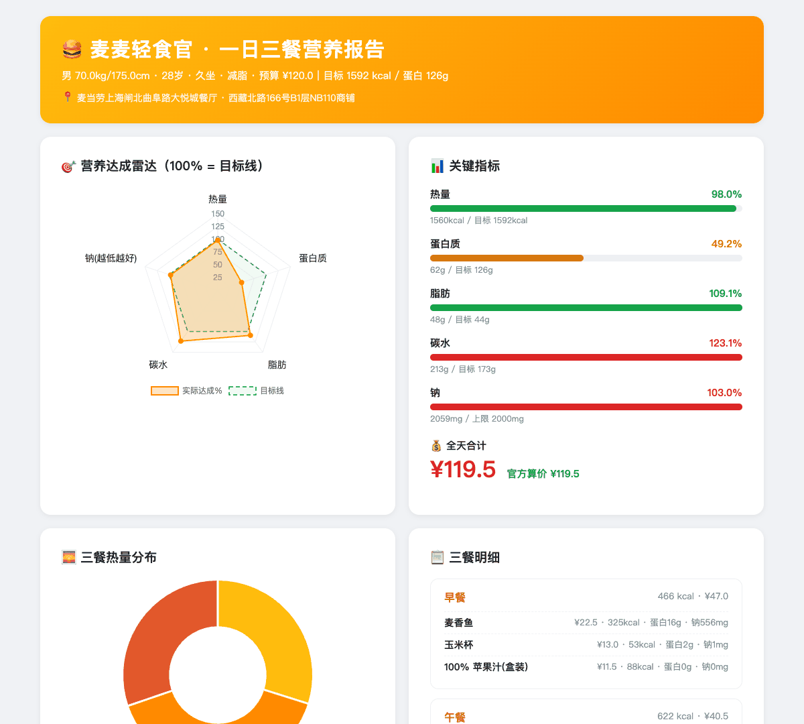
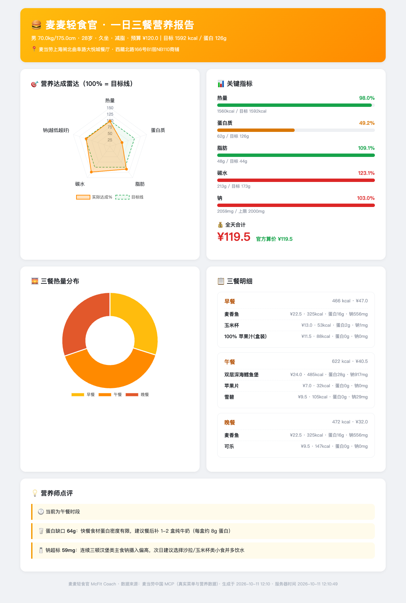

# 🍔 麦麦轻食官 McFit Coach

> 久坐、外卖、想控卡，但又想吃麦当劳？让 MCP 帮你「算着吃」。

简体中文 | **[English](README_EN.md)**

[](https://github.com/dickeryang/mcd-fit-coach/actions/workflows/ci.yml)
 

麦麦轻食官是一个基于 **麦当劳中国 MCP** 的智能点餐助手：输入身体数据与目标（减脂 / 增肌 / 均衡），自动计算每日营养目标，基于麦当劳 **真实菜单与官方营养数据** 组合一日三餐，联动官方算价，最终生成一份可视化的营养报告页。

```text
身高体重目标 ──► 营养目标计算 ──► 真实菜单三餐组合 ──► 官方算价 ──► 可视化营养报告
     (Mifflin-St Jeor)      (麦当劳 MCP 菜单+营养)     (calculate-price)     (Chart.js)
```



## ✨ 核心特性

- **科学目标计算**：Mifflin-St Jeor 公式估算基础代谢，按活动系数与目标（减脂 -20% / 增肌 +15% / 均衡）折算每日热量、蛋白质、脂肪、碳水与钠上限
- **真实数据驱动**：158 个餐品的官方营养数据 + 实时门店菜单，绝不凭空编造餐品
- **两阶段组合算法**：每个餐位全枚举约 840 种「主餐 + 小食 + 饮品」组合（含轻食餐位）取 Top-40，再跨餐位 400 轮随机重组——单方案 80~200ms，实测热量误差 1~6%
- **官方算价联动**：组合结果直接送 `calculate-price` 真实算价，与菜单价分毫不差；联动 `query-store-coupons` 做**门店券-商品直配**，一次算价即出优惠价（不盲试）
- **诚实输出**：快餐营养现实不粉饰——蛋白缺口建议补纯牛奶、钠超标红色警示、预算不可行时明确标注 `over_budget` 而不是硬塞
- **可视化报告**：一键生成 1080px 分享卡片式 HTML 报告（雷达图 / 环形图 / 五维三态进度条 / 营养师点评 / 已用券信息），Chart.js 离线时自动退化为数据表

## 📦 安装

零第三方依赖，纯 Python 标准库（3.10+）：

```bash
git clone https://github.com/dickeryang/mcd-fit-coach.git
cd mcd-fit-coach
```

## 🚀 使用

先到 [麦当劳 MCP 平台](https://open.mcd.cn/mcp) 注册并激活 Token，然后：

```bash
# 一条命令：拉营养库 → 查门店 → 组三餐 → 官方算价 → 生成报告
export MCD_MCP_TOKEN=你的Token
python src/main.py --sex male --weight 70 --height 175 --age 28 \
    --goal cut --budget 120 --seed 7 --report report.html
```

常用参数：

| 参数 | 说明 |
|---|---|
| `--sex` / `--weight` / `--height` / `--age` | 身体数据 |
| `--goal` | `cut` 减脂 / `bulk` 增肌 / `balance` 均衡 |
| `--budget` | 每日预算（元），软约束，超支会在报告中标出 |
| `--city` / `--keyword` / `--store-code` | 门店定位 |
| `--seed` | 固定随机种子，结果可复现 |
| `--report` | 同时生成可视化营养报告 HTML |
| `--no-coupon` | 跳过用券，直接按原价算价 |
| `--bind` | ⚠️ 先一键领取麦麦省可用券（真实入账），再用门店券直配算价 |

也可以安装为命令后使用：

```bash
pip install -e .
mcfc --sex male --weight 70 --height 175 --age 28 --goal cut --report report.html
```

也可以只从已有方案 JSON 生成报告：

```bash
python src/report.py --input docs/samples/demo-input.json -o report.html
```

## 📊 输出示例

真实运行的方案示例见 [`docs/samples/demo-report.html`](docs/samples/demo-report.html)（浏览器打开，图表需联网加载 Chart.js）与 [`docs/samples/demo-input.json`](docs/samples/demo-input.json)。

完整报告页截图（1200×1783）：



## 🎯 目标用户

- **健身减脂人群**：想控卡又馋麦当劳，需要「能吃的方案」而不是「不能吃清单」
- **久坐程序员**：一天三顿外卖，想让快餐吃得有依据
- **MCP / Agent 开发者**：把本项目当作麦当劳 MCP 的完整工程化参考实现（无状态客户端、营养库缓存、组合优化、报告生成）

## 🧱 项目结构

```text
mcd-fit-coach/
├── src/
│   ├── mcd_client.py    # 麦当劳 MCP 无状态客户端（握手/调用/JSON 提取）
│   ├── nutrition.py     # 营养知识库解析 + 每日目标计算
│   ├── meal_planner.py  # 菜单对齐 + 两阶段三餐组合算法
│   ├── coupon.py        # 门店可用券查询 + 券-商品直配算价
│   ├── main.py          # CLI 全流程入口
│   └── report.py        # 可视化营养报告生成器
├── tests/test_core.py   # 核心链路回归测试（离线可跑）
├── pyproject.toml       # 零依赖打包 + `mcfc` 命令入口
├── .github/workflows/   # CI：Python 3.10-3.13 矩阵 + ruff
└── docs/                # 开发笔记与真实返回样本
```

## 🧪 开发与测试

零第三方依赖，测试完全离线（不需要 Token）：

```bash
python tests/test_core.py     # 营养解析 / 目标计算 / 菜单对齐 / 三餐组合 / 券直配 / 报告
ruff check .                  # 代码风格检查（可选：pip install ruff）
```

## ❓ 故障排查

| 现象 | 原因与处理 |
|---|---|
| `HTTP 401` | Token 无效或过期，到 [open.mcd.cn/mcp](https://open.mcd.cn/mcp) 重新激活并更新 `MCD_MCP_TOKEN` |
| `600012 未找到优惠券` | 券码取错了来源——必须用 `query-store-coupons` 返回的券码，不能用户卡包/领券结果里的（见 [MCP_INTEGRATION.md](MCP_INTEGRATION.md) 发现 3） |
| 卡包无券 / 不加价 | 该门店当前可能没有适用券，属正常；`--bind` 可先领券，`--no-coupon` 可跳过用券 |
| 报告页图表空白 | Chart.js 走 CDN，离线时会自动退化为数据表（不会空白） |
| 早餐餐位退化 / 不可售 | 菜单是按时段返回的，晚间无早餐品类；程序会给出时段提示 |

## 🧭 设计边界

- **刻意不下单**：本项目定位「餐前决策」（吃什么、多少钱），不调用 `create-order`，真实下单交给你在麦当劳官方渠道完成（详见 [MCP_INTEGRATION.md](MCP_INTEGRATION.md)）
- **诚实输出**：营养目标在快餐场景下不可达时（如蛋白缺口、钠超标、预算不足），如实标注而非粉饰
- **数据以官方为准**：营养与菜单来自 MCP 实时返回，仅作参考，不构成医疗/营养建议
- **不接入的特制选项**：实测可乐等饮品的 `modification` 仅有冰量等不影响营养的选项，「无糖」是独立 SKU 而非特制项，故不接入（避免无收益的复杂度）

## 🗺 Roadmap

- [ ] 周计划（一周 7 天不重复，跨天营养均衡）
- [ ] 钠超标自动替换（等价热量下局部搜索降钠）
- [ ] 门店对比（同城不同门店的菜单与价格差异）
- [ ] 过敏原 / 忌口过滤（基于营养表 `description` 字段）
- [ ] 报告英文版（`--lang en`，与 README_EN 配套）

## ⚠️ 免责声明

本项目为麦当劳程序员节创意开发大赛参赛作品，由参赛者独立开发，非麦当劳官方产品。项目输出仅供参考，不构成医疗、营养或其他专业建议；餐品信息、价格及供应状态以麦当劳官方渠道的实时结果为准。详见 [CONTEST_DECLARATION.md](CONTEST_DECLARATION.md)。

## 📄 License

[MIT](LICENSE)
